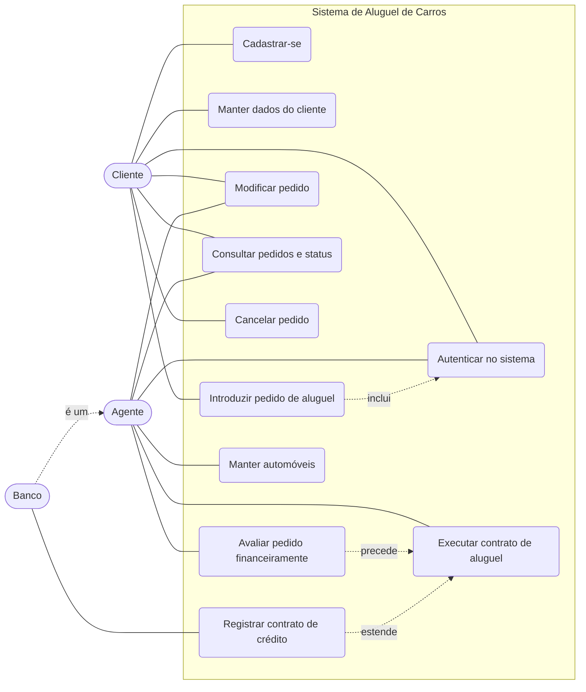

# Diagrama de casos de uso

Atores: Cliente (usuário individual), Agente (empresa ou banco). O Banco é um tipo de agente que também pode conceder crédito.

## Descrição resumida

| Caso de uso | Ator | Descrição |
|---|---|---|
| Cadastrar-se | Cliente | cria o usuário (login e senha) e os dados de identificação, profissão e rendimentos (máximo 3) |
| Autenticar no sistema | Cliente, Agente | login obrigatório com usuário e senha para usar qualquer funcionalidade |
| Manter dados do cliente | Cliente, Agente | consultar, alterar e excluir cliente (CRUD) |
| Introduzir pedido de aluguel | Cliente | escolhe um automóvel e o período; o pedido nasce com status EM_ANALISE |
| Modificar pedido | Cliente, Agente | altera automóvel ou período enquanto o pedido está EM_ANALISE |
| Consultar pedidos e status | Cliente, Agente | cliente vê os seus pedidos; agente vê todos |
| Cancelar pedido | Cliente | cancela um pedido EM_ANALISE ou APROVADO (ainda sem contrato) |
| Avaliar pedido financeiramente | Agente | dá parecer positivo (APROVADO) ou negativo (REPROVADO) |
| Executar contrato de aluguel | Agente | para pedido APROVADO, define quem é o proprietário do automóvel (cliente, empresa ou banco) |
| Registrar contrato de crédito | Banco | opcionalmente associa um crédito concedido pelo banco ao contrato |
| Manter automóveis | Agente | cadastra automóveis (matrícula, ano, marca, modelo, placa) |
