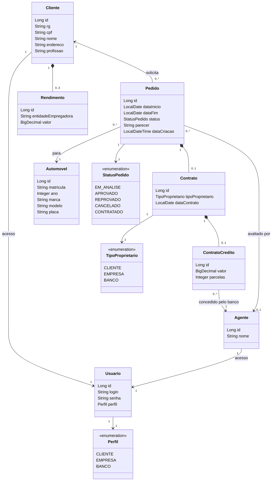

# Diagrama de classes

Os nomes das classes e atributos são os mesmos do código em `backend/src/main/java/br/pucminas/aluguel/model`.

## Decisões de modelagem

- Cliente e Agente (empresa ou banco) têm um Usuario cada, que guarda login, senha e perfil. O perfil decide o que a pessoa pode fazer.
- O enunciado diz que o automóvel pode ser propriedade de clientes, empresas ou bancos conforme o tipo de contrato. Por isso o proprietário fica no Contrato (TipoProprietario) e não no Automovel.
- O contrato de crédito é opcional e só existe dentro de um contrato. O agente dele precisa ter perfil BANCO.
- Máximo de 3 rendimentos por cliente: validado no back-end (DTO e serviço) e no front-end.
