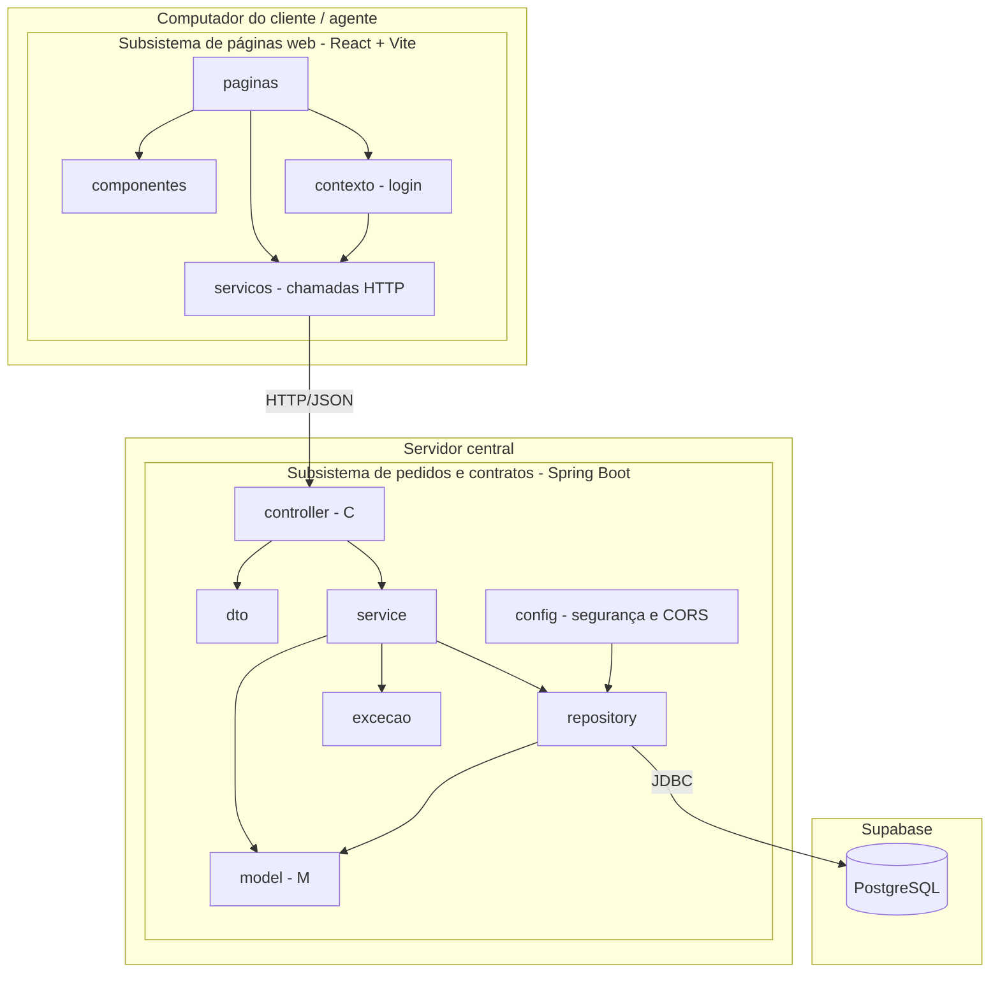

# Diagrama de pacotes (visão lógica)

O enunciado divide o sistema em dois subsistemas: gestão de pedidos e contratos, e construção dinâmica das páginas web. O primeiro é o back-end Spring Boot (MVC) e o segundo é o front-end React.

## Mapeamento pacote para pasta

| Pacote | Pasta | Papel no MVC |
|---|---|---|
| controller | `backend/src/main/java/br/pucminas/aluguel/controller` | Controller: recebe as requisições HTTP |
| service | `.../service` | regras de negócio |
| model | `.../model` | Model: entidades JPA e enums |
| repository | `.../repository` | acesso ao banco |
| dto | `.../dto` | objetos de entrada e saída da API |
| config | `.../config` | segurança (login), CORS e dados iniciais |
| excecao | `.../excecao` | erros de negócio e tratamento global |
| View | `frontend/src` | a View é o front-end React, que consome a API JSON |

Nota: como o front-end é React, a camada View do MVC fica fora do Spring. O Spring entrega JSON e o React monta as páginas.
